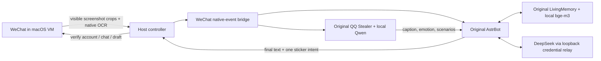

# 架构 / Architecture

One macOS guest handles the logged-in WeChat UI; the host runs the controller and QQ framework. A second Linux VM is not required. The guest receives no DeepSeek API key. The credential relay and local control ports bind loopback.

`app/visual_adapter.py` reads visible content with macOS Vision and identifies the selected chat. `guest_adapter.py` contains native control primitives. `sticker_adapter.py` opens Favorites, resets to the top, verifies anchors, scrolls to a calibrated row, verifies the target thumbnail, clicks once and observes the outgoing image.

`plugins/wechat_vm_transport` preserves group/speaker metadata in AstrBot's actual pipeline. Caption results are cached by crop hash. Recent media associations expire after five minutes and remain scoped to the same chat; they supply the missing referent when a passive image is followed by an addressed text question. This is transport context, not a replacement memory algorithm.

The original LivingMemory provides storage, recall and reflection. Slang/sticker corrections should record observations, uncertainty and examples; one observation is not a group-wide preference. Bot outputs must not become evidence of human preferences. Vision descriptions are fallible, so literal visible content and inferred meme meaning must remain distinct.

Private owner scope and group scopes differ. Renamed groups retain a user-confirmed selected-avatar binding; collage/member/avatar changes may invalidate it. This is not a stable server-side WeChat group ID.

A busy group may continue speaking while a reply is generated. Verified appended incoming messages do not cancel the original addressed response; a new manual outgoing response still cancels it. Only the final event in a batch may produce an outgoing action.

`app/supervise_controller.py` can restart an owned listener in the same logged-in host session. `COMPANION_AUTO_RESUME=1` opts into persisted run/pause intent; pending uncertain sends and account checks still block resuming. No host reboot/unlock guarantee is made.
